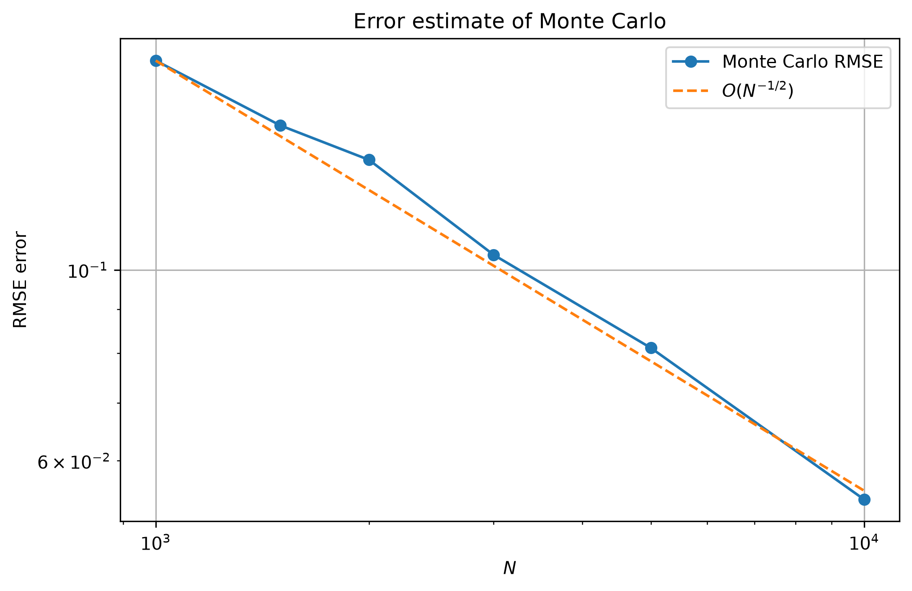
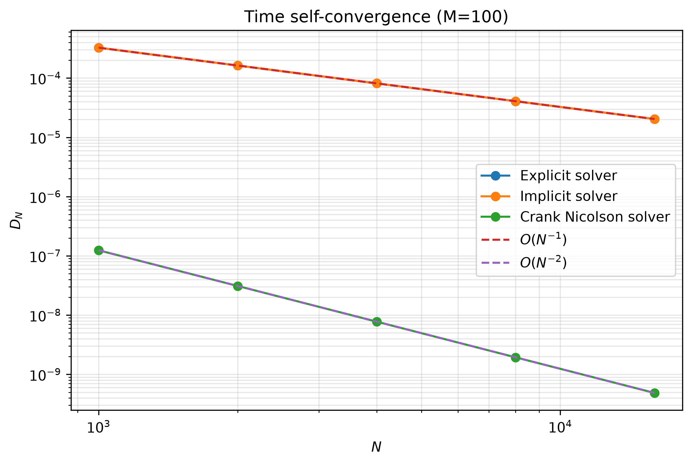
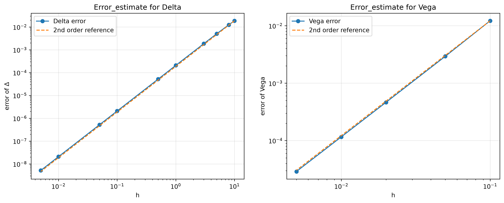
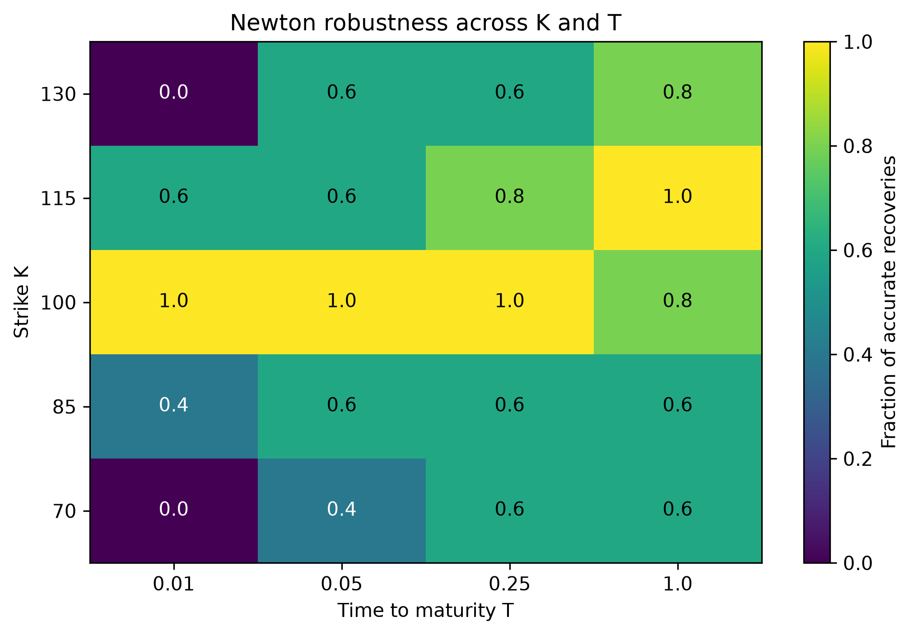
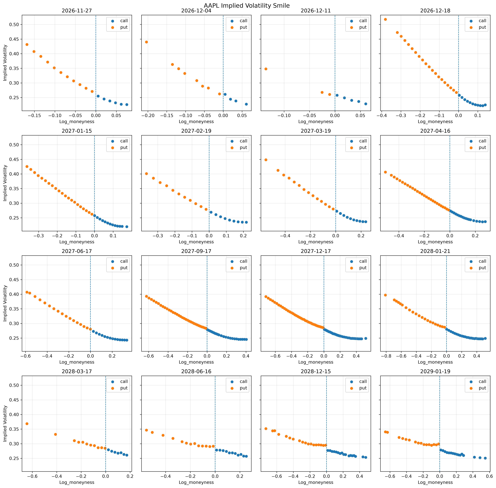
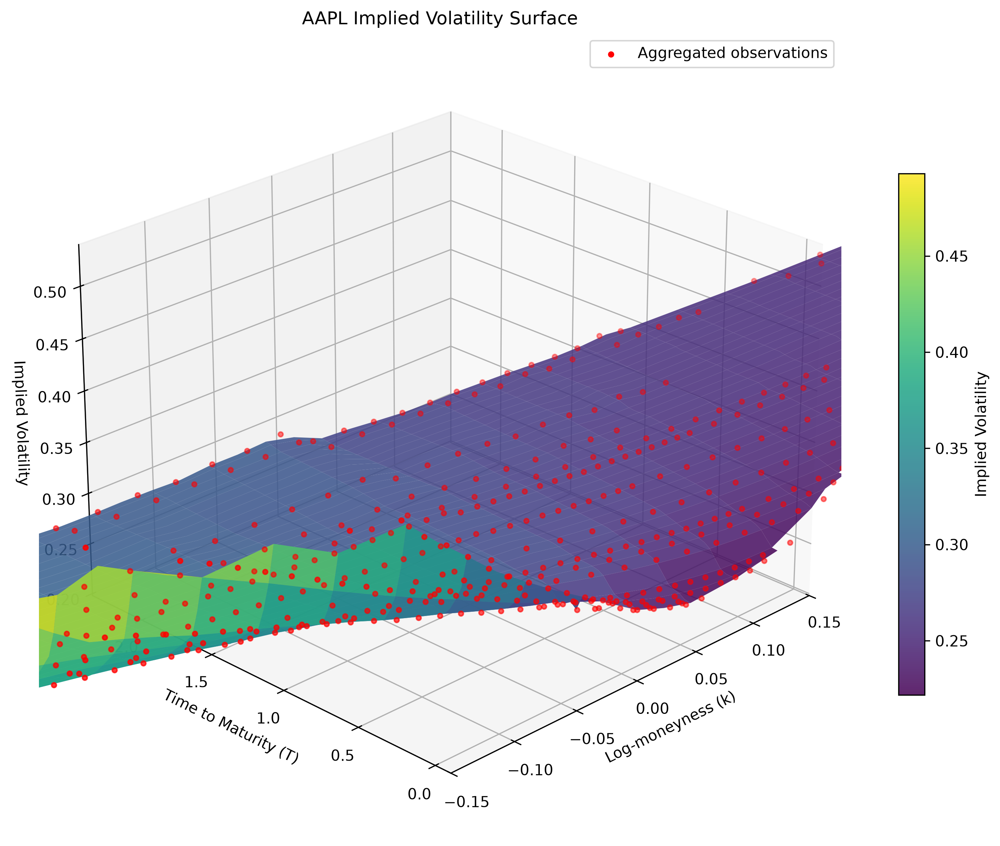

# Option Pricing and Implied Volatility Analysis

A Python-based quantitative finance learning project that moves from **model-based option pricing** to **numerical methods** and finally to **market-implied volatility analysis using AAPL option data**.

The project contains five connected experiments, supported by reusable Python modules, numerical convergence tests, and an empirical option-chain study. It focuses on understanding and validating the methods rather than building a production trading or pricing system.

## Project at a Glance

| Experiment | Main methods | What it investigates |
|---|---|---|
| **01. Option Pricing** | Black--Scholes, Monte Carlo | Analytical pricing benchmark and simulation convergence |
| **02. PDE Valuation** | Explicit, implicit, Crank--Nicolson | Finite-difference pricing and temporal/spatial accuracy |
| **03. Greeks Analysis** | Analytical Greeks, bump-and-reprice, PDE | Delta and Vega estimation and numerical convergence |
| **04. Implied Volatility** | Bisection, Newton, Brent | Root-finding accuracy, convergence, and stability |
| **05. AAPL Volatility Analysis** | Option-chain cleaning, IV inversion, interpolation | Market volatility smile, ATM-forward term structure, and surface |

### Key Numerical Findings

- **Monte Carlo:** the empirical RMSE slope is approximately **-0.514**, consistent with the theoretical \(N^{-1/2}\) rate.
- **PDE methods:** explicit and implicit schemes show approximately **first-order temporal convergence**; Crank--Nicolson shows approximately **second-order temporal convergence**. The spatial experiment also approaches second-order accuracy.
- **Greeks:** central bump-and-reprice estimates show approximately second-order convergence for both Delta and Vega.
- **Implied volatility:** in the controlled test, Bisection takes 27 iterations while Newton takes 4 from the selected initial guess. In the selected Newton stability grid, 63 of 100 cases meet the prescribed volatility-error tolerance; low Vega is a key source of difficulty.
- **AAPL application:** the 2026-11-06 option-chain snapshot contains **2,152 contracts across 16 expirations**. The main plots use OTM options with a **20% relative bid--ask spread filter**.

## Selected Results

The figures below provide a visual summary of the numerical experiments and the final AAPL application. All ten figures are available in [`figures/`](figures/).

<table>
<tr>
<td width="50%" valign="top">

<p align="center"><strong>01 · Monte Carlo convergence</strong><br>RMSE decreases at approximately the theoretical inverse-square-root rate.</p>
</td>
<td width="50%" valign="top">

<p align="center"><strong>02 · PDE temporal convergence</strong><br>Comparison of explicit, implicit, and Crank--Nicolson schemes.</p>
</td>
</tr>
<tr>
<td width="50%" valign="top">

<p align="center"><strong>03 · Greeks convergence</strong><br>Central-difference estimates for Delta and Vega.</p>
</td>
<td width="50%" valign="top">

<p align="center"><strong>04 · Newton stability</strong><br>Recovery success across strike and maturity combinations.</p>
</td>
</tr>
<tr>
<td width="50%" valign="top">

<p align="center"><strong>05 · AAPL volatility smile</strong><br>OTM implied volatilities across expirations.</p>
</td>
<td width="50%" valign="top">

<p align="center"><strong>05 · AAPL volatility surface</strong><br>Interpolated implied volatility over log-moneyness and maturity.</p>
</td>
</tr>
</table>

The [AAPL ATM-forward term structure](figures/05_AAPL_term_structure.png) is also included in the figures folder.

## Experiments

### 01. Option Pricing

This experiment introduces the European option pricing framework with a continuous dividend yield. Under the risk-neutral measure,

\[
dS_t=(r-q)S_t\,dt+\sigma S_t\,dW_t,
\]

where \(r\) is the risk-free rate, \(q\) is the continuous dividend yield, and \(\sigma\) is volatility.

A European put is priced using the **Black--Scholes analytical formula** as a benchmark and **Monte Carlo simulation**, which simulates terminal stock prices and discounts the payoff. The experiment repeats the Monte Carlo calculation for different path counts and estimates RMSE against the analytical price.

### 02. PDE Valuation

The Black--Scholes PDE for a European put with continuous dividend yield is

\[
P_t+(r-q)SP_S+\frac{1}{2}\sigma^2S^2P_{SS}-rP=0.
\]

Three finite-difference schemes are implemented: explicit, implicit, and Crank--Nicolson. The notebook studies temporal convergence, spatial convergence, and pricing/runtime differences. The experiments illustrate first-order temporal accuracy for the explicit and implicit schemes, second-order temporal accuracy for Crank--Nicolson, and second-order spatial accuracy from central differences.

### 03. Greeks Analysis

The experiment studies the sensitivity of a European put price to the underlying stock price and volatility:

\[
\Delta=\frac{\partial P}{\partial S_0},\qquad
\mathrm{Vega}=\frac{\partial P}{\partial \sigma}.
\]

Analytical Black--Scholes Greeks are compared with bump-and-reprice estimates using central finite differences and Greeks estimated from the numerical PDE solution. Spatial and temporal refinement experiments examine the accuracy of PDE-based Greeks. The notebook also illustrates why a fixed spatial grid can leave a nonzero error floor as the time step is reduced.

### 04. Implied Volatility

Implied volatility is formulated as a root-finding problem:

\[
P_{\mathrm{BS}}(\sigma_{\mathrm{imp}})=P_{\mathrm{input}}.
\]

The notebook implements and compares **Bisection**, a robust bracketed method, and **Newton's method**, which can converge rapidly when the initial guess is suitable and Vega is not too small. The experiments compare iteration counts and convergence behavior, then study Newton's sensitivity to strike, maturity, and initial volatility. For these controlled solver tests, option prices are generated from the Black--Scholes model using prescribed volatilities; they are synthetic prices rather than independent market quotes.

A small pricing residual does not always imply an accurate implied-volatility estimate. Since

\[
\frac{\partial \sigma_{\mathrm{imp}}}{\partial P}=\frac{1}{\mathrm{Vega}},
\]

the inversion can be sensitive when Vega is small, for example for options far from at-the-money or with short maturities.

### 05. AAPL Volatility Smile and Surface

The final experiment applies the pricing and implied-volatility tools to an AAPL option-chain snapshot dated **2026-11-06**. The workflow is:

1. Load the saved AAPL option-chain and U.S. Treasury-rate data.
2. Set the valuation inputs, including spot price and continuous dividend yield.
3. Clean option quotes and calculate relative bid--ask spreads.
4. Retain out-of-the-money (OTM) options for the main volatility analysis.
5. Calculate Black--Scholes implied volatilities from option mid-quotes using Brent's root-finding method.
6. Plot the volatility smile, ATM-forward term structure, and a 3D implied-volatility surface.
7. Compare the term structure under different relative-spread filters.

Main valuation inputs:

- Valuation date: `2026-11-06`
- Underlying: `AAPL`
- Spot price: \(S_0=342.36\)
- Continuous dividend yield: \(q=0.00315\)
- Risk-free rates: maturity-dependent rates derived from the saved U.S. Treasury data.

The saved option-chain dataset contains 2,152 contracts across 16 expiration dates, spanning approximately 21 to 805 calendar days. After cleaning, 1,945 contracts remain, including 984 OTM contracts before the relative-spread filter. The main plots use a 20% relative bid--ask spread threshold, retaining 500 OTM observations. The notebook also compares 10%, 15%, 20%, and 30% thresholds to illustrate the trade-off between quote quality and data coverage.

The observed smiles generally exhibit a negative equity skew: lower-strike OTM puts tend to have higher implied volatilities than higher-strike OTM calls. The ATM-forward term structure is estimated by linear interpolation between observations that bracket zero log-moneyness.

## Methodological Notes and Limitations

The results should be interpreted as a learning exercise rather than as a production valuation or trading system.

- **European versus American exercise:** AAPL listed equity options are American-style, while the implied-volatility inversion uses the European Black--Scholes formula as an approximation.
- **Dividend modeling:** the continuous dividend yield approximates discrete cash dividends.
- **Risk-free curve:** the inputs are based on quoted U.S. Treasury par yields and the project's interpolation procedure, not a bootstrapped zero-coupon curve. For maturities shorter than the shortest available Treasury tenor, the current routine uses the first available tenor's rate.
- **Quote synchronization:** the selected stock reference price is close to the 15:59 stock close on the valuation date, but a reliable timestamp for every individual option bid and ask is unavailable. Exact synchronization cannot therefore be guaranteed.
- **Spread filtering:** the 20% relative-spread threshold is a practical choice for this dataset, not a universally optimal cutoff.
- **Surface construction:** the 3D surface is obtained by linear interpolation of observed implied-volatility points. It is a visualization of sampled data, not an arbitrage-free volatility-surface calibration or a forecasting model.
- **Numerical tolerances:** root-finding success and a small pricing residual do not by themselves guarantee that the recovered implied volatility is economically reliable, especially when Vega is small.

## Repository Structure

A suggested project layout is:

```text
dividend-aware-option-analysis/
├── README.md
├── notebooks/
│   ├── 01_option_pricing.ipynb
│   ├── 02_pde_valuation.ipynb
│   ├── 03_greeks_analysis.ipynb
│   ├── 04_implied_volatility.ipynb
│   └── 05_volatility_smile.ipynb
├── report/
│   ├── report.tex
│   ├── report.pdf
│   └── figures/
├── src/
│   ├── black_scholes.py
│   ├── monte_carlo.py
│   ├── pde_solver.py
│   ├── greeks.py
│   ├── implied_volatility.py
│   └── market_analysis/
│       ├── data_loader.py
│       ├── data_cleaning.py
│       ├── iv_surface.py
│       └── plotting.py
├── data/
│   └── raw/
└── figures/
```

The notebooks expect the core modules to be importable from the project source directory. Adjust paths if your local repository layout differs.

## Requirements

The notebooks use Python 3 and common scientific packages: NumPy, pandas, SciPy, Matplotlib, yfinance, and Jupyter Notebook or JupyterLab.

```bash
pip install numpy pandas scipy matplotlib yfinance jupyter
```

## Running the Notebooks

1. Clone or download the repository and install the dependencies above.
2. Keep the notebooks, source modules, `data/`, and `figures/` in the expected relative locations, or update the project paths in the notebooks.
3. Run Experiments 01--04 in order.
4. For Experiment 05, make sure the following files are available under `data/raw/`:
   - `AAPL_options_20261106.csv`
   - `daily-treasury-rates_20261106.csv`
   - `risk_free_rate_20261106.csv` (the maturity-dependent rates prepared from the Treasury data)
5. If needed, rerun the rate-preparation cell in Notebook 05 to regenerate `risk_free_rate_20261106.csv`. The cleaning cells then create the cleaned and OTM option datasets under `data/processed/`.
6. Run the IV calculation and plotting cells to generate the smile, term-structure, and surface figures.

The historical option-chain download cell in Notebook 05 is commented out because the snapshot has already been downloaded and saved locally. Re-run or adapt it only when collecting a new dataset. If the Yahoo Finance proxy setting (`http://127.0.0.1:7897`) does not match your network environment, change or remove it.

## Outputs

Depending on which cells are executed, the project produces numerical option prices, convergence tables and plots, PDE temporal/spatial results, analytical and numerical Delta/Vega comparisons, Bisection/Newton convergence and stability results, cleaned option datasets, and AAPL smile/term-structure/surface figures.

## Scope

This project demonstrates foundational option-pricing and numerical-analysis techniques in Python. The code prioritizes clarity and reproducibility over production-level performance, extensive validation, or live trading functionality.
